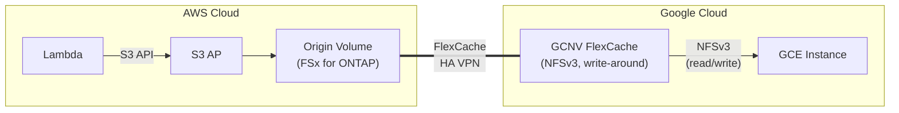

> 🌐 Language: [日本語](../ja/demo-guide-06-flexcache-gcnv.md) | **English**

# Demo Guide 06: FlexCache GCNV (FSx for ONTAP → Google Cloud NetApp Volumes)

> **Time Required**: ~90min(if VPN already configured)
> **Cost**: ~$15–25（AWS + GCP combined, if deleted after verification）
> **Audience**: engineers exploring GCP native storage + AWS data integration
> **ONTAP Version**: FSx 9.17.1+ / GCNV（Google-managed、バージョン自動）

---

> ⚠️ **Validation Status**: Procedure-level guide (not yet E2E validated in a live environment).
> Commands and architecture are based on official documentation and patterns validated in Guide 01/02 (same-region / cross-region FSx for ONTAP).
> External environment required for full validation — see BACKLOG items 7–12.


## What This Demo Validates

```
AWS Cloud (ap-northeast-1)                  Google Cloud (us-central1)
┌────────────────────────────┐              ┌────────────────────────────┐
│  Lambda ──S3 API──▶ S3 AP  │              │                            │
│        │                   │              │  Google Cloud NetApp       │
│        ▼                   │  HA VPN      │  Volumes (GCNV)            │
│   Origin Volume            │◄════════════▶│    FlexCache Cache Volume  │
│   (FSx for ONTAP)         │  Intercluster│           │                │
│                            │              │    NFSv3 mount             │
│                            │              │   (GCE instance)           │
└────────────────────────────┘              └────────────────────────────┘
```




**Key Constraints:**

**Key constraints (revised against primary sources on 2026-11-04):**

| Constraint | Details |
|------|------|
| Only ONTAP-mode can be an origin | Default-mode GCNV volumes serve as cache only. **Flex Unified ONTAP-mode volumes can also act as origin volumes** ([GCP: FlexCache overview](https://docs.cloud.google.com/netapp/volumes/docs/configure-and-use/volumes/cache-ontap-volumes/overview)) |
| NFSv3 is the main line | This demo uses NFSv3. NFSv4 access to a cache is ONTAP 9.10.1 and later |
| Not read-only (write-around) | **GCNV FlexCache is writable.** With the default write-around, a write to the cache is forwarded to the origin and committed there. Write-back is a separate option (ONTAP 9.15.1 and later). A rejected write is caused not by read-only but by the origin-side UNIX permissions (see below) |
| Two management paths | ONTAP-mode has no direct SSH / System Manager. Operate it through `gcloud netapp storage-pools execute` (CLI proxy) and the Google proxy API (ONTAP REST) |

**Validation Points:**

| # | Validation Item | Protocol |
|:-:|---------|-----------|
| 1 | Lambda writes data to Origin via S3 AP | S3 |
| 2 | NFSv3 data access via GCNV FlexCache | NFSv3 |
| 3 | Origin update → GCNV Cache propagation latency | NFSv3 |

---

> ⚠️ **Validation Status**: Procedure-level guide (not yet E2E validated in a live environment).
> Commands and architecture are based on official documentation and patterns validated in Guide 01/02 (same-region / cross-region FSx for ONTAP).
> External environment required for full validation — see BACKLOG items 7–12.


## Prerequisites

[Common Prerequisites](../en/demo-guide-00-prerequisites.md) plus the following:

| Resource | Cloud | Description |
|----------|---------|------|
| FSx for ONTAP | AWS | Origin Volume |
| GCNV Storage Pool + Volume | GCP | FlexCache Cache |
| HA VPN | AWS ↔ GCP | encrypted tunnel |
| GCP VPC (PSA 有効) | GCP | Private Service Access for GCNV |

### Additional Tools

| Tool | Purpose |
|--------|------|
| `gcloud` CLI | GCP / GCNV リソース管理 |

---

> ⚠️ **Validation Status**: Procedure-level guide (not yet E2E validated in a live environment).
> Commands and architecture are based on official documentation and patterns validated in Guide 01/02 (same-region / cross-region FSx for ONTAP).
> External environment required for full validation — see BACKLOG items 7–12.


## Step 0: Set Environment Variables

```bash
# === AWS Side ===
export AWS_REGION="ap-northeast-1"
export FS_ID="fs-0EXAMPLE1234abcde"
export SVM_NAME_AWS="svm-origin"
export SECRET_ARN="arn:aws:secretsmanager:ap-northeast-1:123456789012:secret:fsxn-admin-XXXXXX"

# === GCP Side ===
export GCP_PROJECT="my-project-123456"
export GCP_REGION="us-central1"
export GCP_ZONE="us-central1-a"
export GCP_VPC="gcnv-vpc"
export GCP_CIDR="10.150.0.0/16"

# === Common ===
export ORIGIN_VOL="vol_gcnv_origin"
```

---

> ⚠️ **Validation Status**: Procedure-level guide (not yet E2E validated in a live environment).
> Commands and architecture are based on official documentation and patterns validated in Guide 01/02 (same-region / cross-region FSx for ONTAP).
> External environment required for full validation — see BACKLOG items 7–12.


## Step 1: GCP HA VPN 設定

> The VPN setup procedure follows [Demo Guide 04 Step 1](../en/demo-guide-04-flexcache-cvo-gcp.md#step-1-create-gcp-ha-vpn) . Configure HA VPN between AWS and GCP.

```bash
# VPN 接続Verify
gcloud compute vpn-tunnels describe <tunnel-name> \
  --region "$GCP_REGION" --project "$GCP_PROJECT" \
  --format='value(status)'
# Expected value: ESTABLISHED
```

---

> ⚠️ **Validation Status**: Procedure-level guide (not yet E2E validated in a live environment).
> Commands and architecture are based on official documentation and patterns validated in Guide 01/02 (same-region / cross-region FSx for ONTAP).
> External environment required for full validation — see BACKLOG items 7–12.


## Step 2: Create GCNV Storage Pool

```bash
# Configure Private Service Access (required for GCNV)
gcloud compute addresses create gcnv-psa-range \
  --global \
  --purpose VPC_PEERING \
  --prefix-length 20 \
  --network "$GCP_VPC" \
  --project "$GCP_PROJECT"

gcloud services vpc-peerings connect \
  --service netapp.servicenetworking.goog \
  --ranges gcnv-psa-range \
  --network "$GCP_VPC" \
  --project "$GCP_PROJECT"

# Storage Pool 作成
gcloud netapp storage-pools create gcnv-demo-pool \
  --location "$GCP_REGION" \
  --capacity 2048 \
  --service-level PREMIUM \
  --network "$GCP_VPC" \
  --project "$GCP_PROJECT"
```

**Expected Output:**
```
Created storage pool [gcnv-demo-pool].
```

---

> ⚠️ **Validation Status**: Procedure-level guide (not yet E2E validated in a live environment).
> Commands and architecture are based on official documentation and patterns validated in Guide 01/02 (same-region / cross-region FSx for ONTAP).
> External environment required for full validation — see BACKLOG items 7–12.


## Step 3: Create GCNV FlexCache Volume

Create GCNV FlexCache via `gcloud` CLI or GCP Console. Specify FSx for ONTAP Intercluster LIF as Origin.

```bash
# FSx for ONTAP の Intercluster LIF を取得
MGMT_IP=$(aws fsx describe-file-systems --file-system-ids "$FS_ID" \
  --query 'FileSystems[0].OntapConfiguration.Endpoints.Management.IpAddresses[0]' \
  --output text --region "$AWS_REGION")

CREDS=$(aws secretsmanager get-secret-value --secret-id "$SECRET_ARN" \
  --query SecretString --output text --region "$AWS_REGION")
ONTAP_USER=$(echo "$CREDS" | jq -r '.username')
ONTAP_PASS=$(echo "$CREDS" | jq -r '.password')

AWS_IC_LIFS=$(curl -sk -u "${ONTAP_USER}:${ONTAP_PASS}" \
  "https://${MGMT_IP}/api/network/ip/interfaces?services=intercluster_core&fields=ip.address" \
  | jq -r '.records[].ip.address')
echo "AWS Intercluster LIFs: $AWS_IC_LIFS"
```

```bash
# GCNV FlexCache Volume 作成
# ※ GCNV FlexCache は Google Cloud Console または API 経由で作成
# 以下は gcloud netapp volumes create の例（FlexCache パラメータは GA 時点でVerify）

gcloud netapp volumes create gcnv-cache-vol \
  --location "$GCP_REGION" \
  --capacity 1024 \
  --storage-pool gcnv-demo-pool \
  --protocols NFSv3 \
  --share-name gcnv_cache \
  --project "$GCP_PROJECT"

# ※ FlexCache Origin is configured via GCNV Replication / Cache functionality
# 詳細は GCP Console > NetApp Volumes > Volume > Create Cache をrefer to this guide
```

> **Note**: GCNV FlexCache の作成手順は Google Cloud のリリース状況により異なる場合があります。最新 procedureは [GCNV Documentation](https://cloud.google.com/netapp/volumes/docs) をrefer to this guideしてください。

---

> ⚠️ **Validation Status**: Procedure-level guide (not yet E2E validated in a live environment).
> Commands and architecture are based on official documentation and patterns validated in Guide 01/02 (same-region / cross-region FSx for ONTAP).
> External environment required for full validation — see BACKLOG items 7–12.


## Step 4: Origin Volume + S3 AP + Lambda Writer（AWS  side）

> [Demo Guide 01 Step 4-6](../en/demo-guide-01-flexcache-same-region.md#step-4-create-origin-volume--attach-s3-ap) . Refer to this guide.

---

> ⚠️ **Validation Status**: Procedure-level guide (not yet E2E validated in a live environment).
> Commands and architecture are based on official documentation and patterns validated in Guide 01/02 (same-region / cross-region FSx for ONTAP).
> External environment required for full validation — see BACKLOG items 7–12.


## Step 5: NFSv3 Verification（GCE インスタンス）

```bash
# SSH into GCE instance
gcloud compute ssh gcnv-test-vm --zone "$GCP_ZONE" --project "$GCP_PROJECT"

# GCNV マウントポイントVerify
GCNV_MOUNT_IP=$(gcloud netapp volumes describe gcnv-cache-vol \
  --location "$GCP_REGION" --project "$GCP_PROJECT" \
  --format='value(mountOptions.export)')

# NFSv3 mount
sudo mkdir -p /mnt/gcnv_cache
sudo mount -t nfs -o vers=3,hard,rsize=65536,wsize=65536 \
  ${GCNV_MOUNT_IP}:/gcnv_cache /mnt/gcnv_cache

# Verify mount
df -h /mnt/gcnv_cache
```

```bash
# Read data written by Lambda
ls -la /mnt/gcnv_cache/demo-data/
cat /mnt/gcnv_cache/demo-data/sensor-001.json | jq .
```

**Expected Output:**
```json
{
  "sensor_id": "S001",
  "temperature": 23.5,
  "humidity": 65,
  "ts": 1753090800
}
```

> **Note (corrected)**: GCNV FlexCache is not read-only. With the default write-around, a write to the cache is forwarded to the origin and committed there. If a write returns `Permission denied`, the cause is not read-only but the **origin (AWS) volume's UNIX permissions**: when the origin root is `root:root` `755`, a write from an ordinary user is refused. Align the writing user's UID/GID with the origin owner (see "Cross-cloud build and peering" below).

```bash
# Write test (succeeds when the origin-side permissions allow it)
echo "FlexCache write test from GCP" > /mnt/gcnv_cache/demo-data/write-test.txt
cat /mnt/gcnv_cache/demo-data/write-test.txt
# On Permission denied, check the origin-side owner and permissions
```

---

> ⚠️ **Validation Status**: Procedure-level guide (not yet E2E validated in a live environment).
> Commands and architecture are based on official documentation and patterns validated in Guide 01/02 (same-region / cross-region FSx for ONTAP).
> External environment required for full validation — see BACKLOG items 7–12.


## Step 6: Origin 更新 → Cache 反映テスト

```bash
# AWS  side:  Lambda からデータを追加
aws lambda invoke \
  --function-name tc09-s3ap-writer \
  --payload '{"prefix": "demo-data/gcnv-test"}' \
  --cli-binary-format raw-in-base64-out \
  /tmp/gcnv-test.json --region "$AWS_REGION"

# GCE  side: 反映Verify（TTL 経過後）
sleep 60
ls /mnt/gcnv_cache/demo-data/gcnv-test/
```

---

> ⚠️ **Validation Status**: Procedure-level guide (not yet E2E validated in a live environment).
> Commands and architecture are based on official documentation and patterns validated in Guide 01/02 (same-region / cross-region FSx for ONTAP).
> External environment required for full validation — see BACKLOG items 7–12.


## Cleanup

```bash
# 1. GCE: NFS unmount
sudo umount /mnt/gcnv_cache

# 2. Delete GCNV Volume
gcloud netapp volumes delete gcnv-cache-vol \
  --location "$GCP_REGION" --project "$GCP_PROJECT" --quiet

# 3. Delete GCNV Storage Pool
gcloud netapp storage-pools delete gcnv-demo-pool \
  --location "$GCP_REGION" --project "$GCP_PROJECT" --quiet

# 4. VPN 削除（Demo Guide 04 refer to this guide）

# 5. AWS side: Origin Volume + S3 AP 削除（Demo Guide 01 refer to this guide）
```

---

> ⚠️ **Validation Status**: Procedure-level guide (not yet E2E validated in a live environment).
> Commands and architecture are based on official documentation and patterns validated in Guide 01/02 (same-region / cross-region FSx for ONTAP).
> External environment required for full validation — see BACKLOG items 7–12.


## Troubleshooting

| Symptom | Cause | Resolution |
|------|------|------|
| GCNV Volume 作成失敗 | PSA not configured | `vpc-peerings connect` がCompleteしているかVerify |
| NFSv4 マウントNot available | GCNV FlexCache は NFSv3 のみ | `-o vers=3`  flag |
| "Permission denied" (on write) | Origin (AWS) UNIX permissions do not match; not read-only | Align the origin root owner/mode with the writing user (see "Cross-cloud build and peering") |
| Cache にデータが見えない | VPN 経由の接続問題 | Check VPN tunnel status + Intercluster ports |
| TTL 後もデータ反映されない | GCNV Cache is managed by Google | GCP Console で Volume  status verified |

---

> ⚠️ **Validation Status**: Procedure-level guide (not yet E2E validated in a live environment).
> Commands and architecture are based on official documentation and patterns validated in Guide 01/02 (same-region / cross-region FSx for ONTAP).
> External environment required for full validation — see BACKLOG items 7–12.


## Cross-cloud build and peering (supplement)

> **Tier**: `documented`. Paths and constraints are confirmed against public GCP / NetApp / AWS documentation (read in full 2026-11-04). No real IDs, IPs, SVM names, or UID/GIDs; all generalized. Prompted by an external article (a third-party hands-on record, cited at the end of this section) and verified against primary sources; this GCNV configuration was not reproduced in this repository.

When connecting AWS and GCP over HA VPN to build FlexCache, the following matter in addition to the demo steps.

### Network and route propagation

- **Use GLOBAL dynamic routing on the Cloud Router.** Region-scoped routing does not learn routes from other regions' subnets toward the peer (AWS).
- **Enable custom-route exchange on the PSA peering.** GCNV lives on a Google/NetApp-managed backend reached through PSA. Enable the peering's `--export-custom-routes` / `--import-custom-routes` so the Cloud Router carries AWS-learned routes to the GCNV backend.
- **Advertise the GCNV intercluster range on the Cloud Router** so the AWS-side origin can return traffic to the GCNV intercluster IPs.

### MTU and fragmentation

- **HA VPN (IPsec) cannot carry jumbo frames.** If the intercluster ports default to MTU 9000/9001, the IPsec overhead triggers IP fragmentation, which cuts throughput and can drop sessions.
- **Lower both sides' broadcast-domain MTU to a VPN-fitting value (around 1350–1400).** Probe with a fragmentation-forbidden (DF-bit) ping to find the largest size that passes without splitting; a plain ping lets the path fragment silently, so the problem goes unnoticed.

### ONTAP peering (GCNV ONTAP-mode constraints)

- **`cluster peer create` cannot run through the CLI proxy.** It is interactive, so the GCNV side uses the ONTAP REST API ([GCP: Manage ONTAP in ONTAP-mode](https://docs.cloud.google.com/netapp/volumes/docs/ontap/manage-ontap)). The external article shows a CLI-proxy example; Google's documentation directs you to the REST API. Re-check the current documentation before relying on either.
- **Prefer authenticated peering for production.** Generate a passphrase on the GCNV side with `-generate-passphrase` and accept it on the FSx for ONTAP side; that order avoids the interactive-input limitation.
- **Unauthenticated peering has a revert constraint.** With `-no-authentication true`, while any unauthenticated relationship remains you cannot return the cluster-wide policy to authenticated-required (`-is-unauthenticated-access-permitted false`) — an ONTAP property ([NetApp: cluster peer policy modify](https://docs.netapp.com/us-en/ontap-cli/cluster-peer-policy-modify.html)). If you run unauthenticated, bound it with HA VPN encryption and a security-group source restriction, and at teardown delete the peer before reverting the policy.

### Writes and origin permissions

- **A write follows the origin (AWS) UNIX permissions.** If the origin volume root stays `root:root` `755`, a write from an ordinary user on the GCP side returns `Permission denied`. Align the writing user's UID/GID with the origin owner. `777` is a temporary triage step; for a durable setting, scope the owner and return to `755`.

Source (third-party article, origin): a Qiita series on building HA VPN / peering / FlexCache for GCNV ONTAP-mode (author handle: lewip, a 3-part series and others). The claims in this section are verified against the primary sources above.

## References

- [GCP Docs: NetApp Volumes](https://cloud.google.com/netapp/volumes/docs)
- [GCP Docs: Manage ONTAP in ONTAP-mode](https://docs.cloud.google.com/netapp/volumes/docs/ontap/manage-ontap)
- [GCP Docs: FlexCache overview (ONTAP-mode)](https://docs.cloud.google.com/netapp/volumes/docs/configure-and-use/volumes/cache-ontap-volumes/overview)
- [GCP Docs: HA VPN](https://cloud.google.com/network-connectivity/docs/vpn/concepts/overview)
- [NetApp Docs: FlexCache](https://docs.netapp.com/us-en/ontap/flexcache/index.html)
- [NetApp Docs: cluster peer policy modify](https://docs.netapp.com/us-en/ontap-cli/cluster-peer-policy-modify.html)
- [Demo Guide 04: FlexCache CVO on GCP](../en/demo-guide-04-flexcache-cvo-gcp.md)
- [Demo Guide 01: FlexCache 同一リージョン](../en/demo-guide-01-flexcache-same-region.md)
